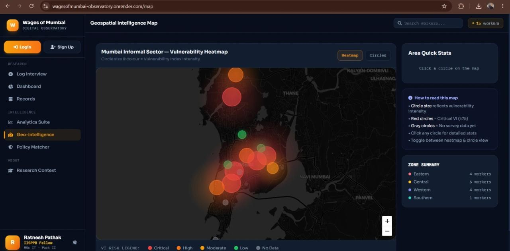

# Wages of Mumbai (WOM): Digital Observatory

A Flask web application that tracks and analyzes income insecurity among women in Mumbai's informal economy, turning field research into a vulnerability score, ward-level maps and policy suggestions. Built during a fellowship at IISPPR.

> This is a **showcase repository**. The source code and the project data live in a private repository. This page documents what the project does and how it is built. Happy to walk through the code on request.
>
> Student portfolio and research project.

[LinkedIn](https://linkedin.com/in/ratnesh-pathak-087466279) | [Email](mailto:pathakratnesh03@gmail.com)

## Preview

## Live Demo

**[Open the live demo](https://wagesofmumbai-observatory.onrender.com/)**

It runs on Render, so the first load can take about a minute while the service wakes up.

## What Is Implemented

| Area | Status |
| --- | --- |
| Vulnerability Index (VI), a multi-factor score built from structured socioeconomic variables | Implemented |
| Ward-level interactive map (Dharavi, Govandi, Kurla) using Leaflet.js | Implemented |
| Policy Matcher, a rule-based link from a vulnerability profile to Government Social Security Schemes | Implemented |
| Interactive charts using Chart.js | Implemented |
| SQLite database with an 18-variable schema | Implemented |
| Deployment on Render with Gunicorn, configured through render.yaml | Implemented |

## Tech Stack

- **Backend:** Python 3.10, Flask, Gunicorn
- **Database:** SQLite
- **Frontend:** HTML, CSS, JavaScript, Chart.js, Leaflet.js
- **Architecture:** Modular MVC
- **Deployment:** Render

## How It Works

Field research -> structured data -> Vulnerability Index -> ward-level map and charts -> matched policy schemes.

## Limitations

- A research prototype. The Vulnerability Index and the policy matching are rule-based and are not an official eligibility check or advice
- The data and source code are not published in this repository
- The live demo is hosted on a free tier, so it may be slow to start

## Author

Ratnesh Pathak - M.Sc. Information Technology, AI / ML Engineer, Founder of Team Ignites

GitHub: [@RatneshPathak](https://github.com/RatneshPathak) | LinkedIn: [Ratnesh Pathak](https://linkedin.com/in/ratnesh-pathak-087466279) | Email: pathakratnesh03@gmail.com

(c) Ratnesh Pathak. All rights reserved. The text and images in this repository may not be reused without permission.
